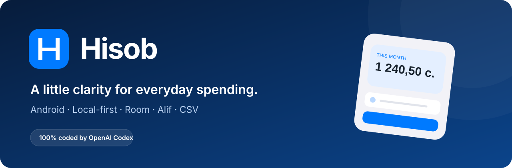
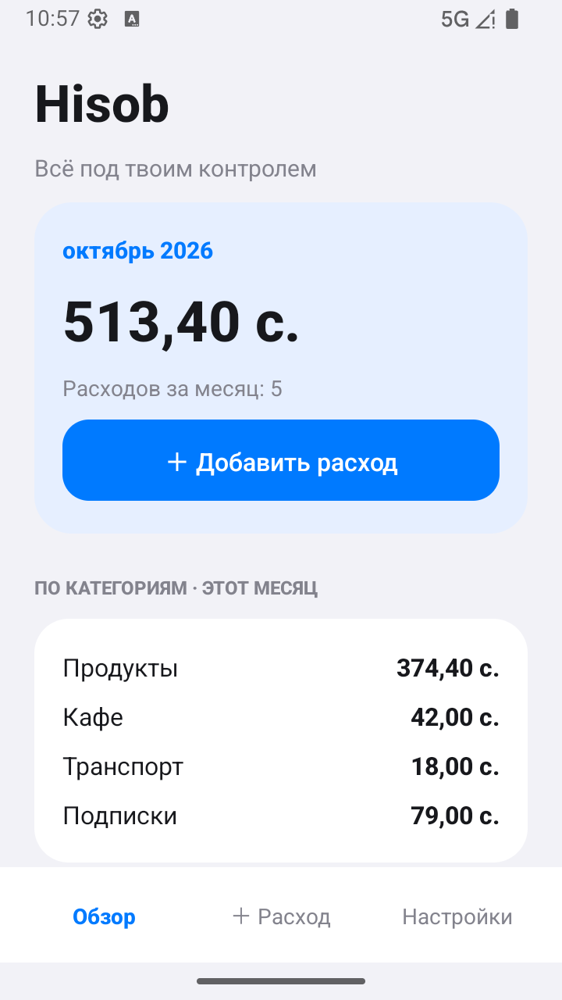
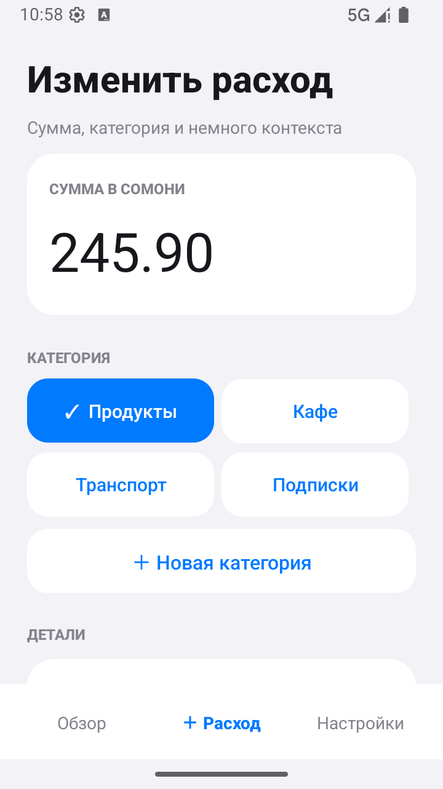
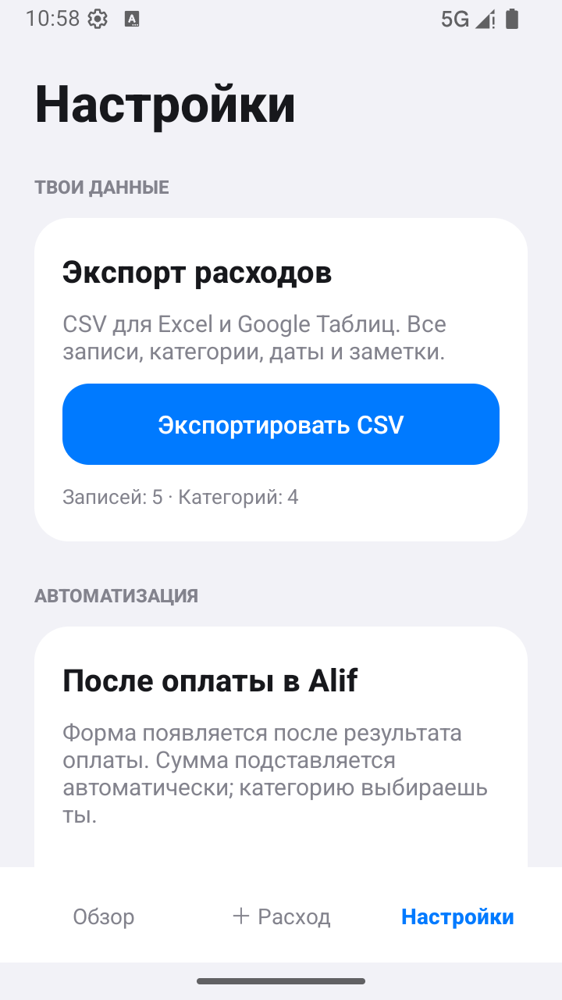

<div align="center">
  
  <br /><br />
  
  
  
  
  
  <br /><br />
  <strong>Твои расходы. Твои категории. Твой телефон.</strong>
  <p>Простой Android-трекер с интерфейсом в стиле iOS,<br />локальной базой и формой после оплаты в Alif.</p>
  <a href="#возможности">Возможности</a> · <a href="#как-это-работает">Как это работает</a> · <a href="#сборка">Сборка</a> · <a href="#сделано-полностью-в-codex">Сделано в Codex</a>
</div>

<br />

## Сделано полностью в Codex

> **«Я не написал ни одной строки кода. Всё приложение полностью сделал OpenAI Codex».**
> — автор идеи, [UmarTuranov](https://github.com/UmarTuranov)

Этот проект создан через диалог с Codex: от первой формы расхода и Android-сервиса до интерфейса, базы Room, переноса старых данных, редактирования, CSV-экспорта, тестов и этого README.

**Роль человека:** идея, требования, обратная связь, тестирование на своём Samsung и выбор дальнейшего направления. **Весь код проекта написан Codex.** Автор идеи не писал код вручную.

Это личный эксперимент: насколько далеко можно довести полезное приложение, описывая желаемый результат обычными словами.

## Скриншоты

<table>
  <tr>
    <td align="center"><strong>Обзор расходов</strong></td>
    <td align="center"><strong>Редактирование</strong></td>
    <td align="center"><strong>Экспорт и настройки</strong></td>
  </tr>
  <tr>
    <td></td>
    <td></td>
    <td></td>
  </tr>
</table>

Все суммы, категории и записи на скриншотах — **вымышленные демонстрационные данные**.

## Возможности

| | Что умеет Hisob |
|---|---|
| **После оплаты** | Замечает поддерживаемый экран результата Alif и открывает форму расхода. |
| **Сумма из Alif** | Ждёт загрузки суммы, подставляет её в форму и позволяет исправить. |
| **Свои категории** | Ты создаёшь категории и сам выбираешь нужную при сохранении. |
| **История** | Обзор текущего месяца, суммы по категориям и фильтр записей. |
| **Редактирование** | Сумма, категория, дата, время и заметка. Нажми на запись в истории. |
| **Удаление** | Удаляет выбранный расход после подтверждения. |
| **CSV для Excel** | Сохраняет все записи через системный выбор файла. |
| **Локальные данные** | Room / SQLite, без регистрации и разрешения на интернет. |

Валюта текущей версии — **таджикский сомони (TJS)**. Интерфейс — на русском.

## Как это работает

```text
Результат оплаты в Alif
        ↓
Сервис специальных возможностей Hisob
        ↓
Ожидание загрузки суммы
        ↓
Проверяешь сумму → выбираешь категорию → сохраняешь
        ↓
Локальная база Room → история, итоги и CSV
```

После установки включи сервис **«Расходы после Alif»** в специальных возможностях Android. Ссылка на настройки есть в Hisob.

Сервис обрабатывает экран приложения `tj.alif.mobi`. Сейчас поддерживаются заголовки **«Платёж отправлен»** и **«Оплата прошла успешно»** вместе с кнопкой **«На главную»**. Перед открытием формы он ждёт минимум 2 секунды, а загрузку устойчивой суммы — до 8 секунд. Если сумма не распознана, её можно ввести вручную.

**Это распознавание интерфейса, а не банковский API.** Новая версия Alif, другой язык или другой экран результата могут потребовать изменения правила. Hisob не выполняет платежи и не нажимает кнопки в Alif. Одинаковые операции с одинаковой суммой за одну минуту могут быть неразличимы для текущей защиты от повторного открытия формы.

## Данные и приватность

- Расходы, категории и настройки хранятся в приватной базе `expenses.db` на телефоне.
- Деньги представлены целым числом в дирамах: `12,50 с.` → `1250`. Без арифметики с `float`.
- Запросы выполняются в отдельном потоке.
- Переход с первой версии на SharedPreferences выполняется одной транзакцией, без дублей при повторном запуске. Исходные данные сохраняются.
- В манифесте нет разрешения `INTERNET`. Данные не отправляются на сервер.
- При удалении приложения или очистке его данных локальная история пропадёт. CSV позволяет сохранить отдельную копию записей; обратного импорта пока нет.

Доступ к специальным возможностям даётся явно через системные настройки. Обработка ограничена Alif; реализацию можно проверить в [`PaymentService.java`](app/src/main/java/local/expenses/PaymentService.java).

## Экспорт

**Настройки → Экспортировать CSV → выбрать папку → Сохранить.**

Файл содержит дату, время, категорию, сумму, валюту и заметку. Формат: UTF-8 с BOM, разделитель `;`, десятичная запятая. Кавычки и многострочные заметки экранируются; текст, похожий на формулу таблицы, нейтрализуется.

Для Excel с другой региональной настройкой выбери импорт CSV с кодировкой UTF-8 и разделителем `;`. Нативного `.xlsx`-экспорта пока нет.

## Сборка

Нужны **JDK 17**, **Android SDK 35** и доступ в интернет для первой загрузки Gradle и зависимостей. Gradle **8.9** поставляется через Wrapper.

```bash
git clone https://github.com/UmarTuranov/hisob.git
cd hisob
```

Открой папку в Android Studio или укажи SDK через `ANDROID_HOME` / `local.properties`:

```properties
# Локальный путь; этот файл не нужно коммитить.
sdk.dir=/path/to/Android/sdk
```

### Для разработки

```bash
./gradlew :app:assembleDebug
```

APK: `app/build/outputs/apk/debug/app-debug.apk`.

Чистый клон использует стандартную debug-подпись Android. Приватные ключи не требуются для debug-сборки и не включены в репозиторий.

### Release

```bash
./build.sh
# или
./gradlew :app:packageRelease
```

Без локального ключа получится **неподписанный release APK**. Для установки подпиши его своим ключом. В локальной среде автора ключ обновлений хранится в `.local/signing.jks`, исключённом из Git. При его наличии сборка использует существующую подпись.

Для обновления уже установленного приложения с сохранением данных нужен **тот же ключ**, которым оно было подписано. Технический `applicationId` сохранён как `local.expenses` ради совместимости с первыми личными сборками.

## Проверки

```bash
./gradlew :app:assembleDebug :app:assembleDebugAndroidTest

adb -s emulator-5554 install -r app/build/outputs/apk/debug/app-debug.apk
adb -s emulator-5554 install -r app/build/outputs/apk/androidTest/debug/app-debug-androidTest.apk
adb -s emulator-5554 shell am instrument -w \
  local.expenses.test/local.expenses.LedgerChecks
```

Инструментальные проверки покрывают:

- транзакционный перенос истории и восстановление используемых категорий;
- точность денежных значений и отсутствие дублей после повторного переноса;
- редактирование и удаление по постоянному ID;
- UTF-8, CSV-экранирование и обработку формул;
- отказ от неполной миграции при повреждённых исходных данных.

Тесты данных работают в изолированных in-memory базах. В `docs/ci/android.yml` лежит шаблон GitHub Actions для сборки debug APK и тестового APK. Автоматизация пока не включена; инструментальные проверки запускаются отдельно на Android-эмуляторе.

## Внутри проекта

```text
app/
├── src/main/java/local/expenses/
│   ├── MainActivity.java        # Интерфейс и пользовательские действия
│   ├── PaymentService.java      # Распознавание результата Alif
│   ├── AmountParser.java        # Извлечение суммы
│   ├── LedgerDatabase.java      # Room и перенос старых данных
│   ├── LedgerDao.java           # Запросы к базе
│   └── CsvExport.java           # Экспорт для таблиц
├── src/androidTest/             # Проверки и синтетические демоданные
└── schemas/                     # Версионируемая схема Room
docs/ci/android.yml              # Шаблон автоматической сборки
AGENTS.md                        # Контекст для продолжения работы в Codex
```

## Статус

Личный рабочий прототип, проверенный на Android-эмуляторе и Samsung Galaxy A56. Автоматизация зависит от версии и интерфейса Alif. Облачной синхронизации, импорта CSV, мультивалютности и банковской сверки пока нет.

Hisob — независимый проект, не официальный продукт Alif или OpenAI.

---

<div align="center">
  <strong>Идея человека. Реализация Codex. Ни одной строки кода вручную.</strong>
</div>
